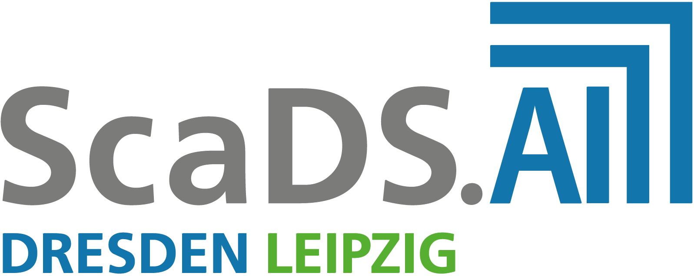
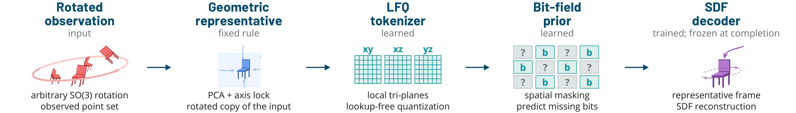
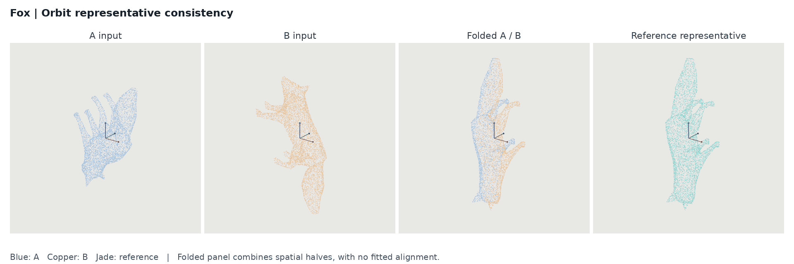
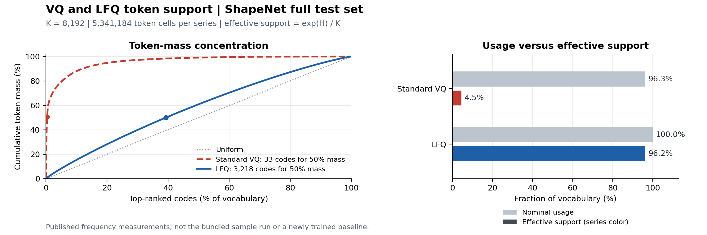

<!-- Geometric Orbit Representatives for Unaligned 3D Tokenization -->
<!-- Chair of Multimodal Machine Learning, ScaDS.AI Dresden/Leipzig -->
<!-- Contact: Xiang Chen <xiang.chen@uni-leipzig.de> | SPDX-License-Identifier: MIT -->

# Geometric Orbit Representatives for Unaligned 3D Tokenization

<p align="center">
  <!-- Replace the PDF status with its official link once the paper is available. -->
  <strong>Paper PDF:</strong> Coming soon &nbsp;&middot;&nbsp; <a href="#citation">BibTeX</a>
</p>

<p align="center">
  <a href="https://scads.ai/"></a>&nbsp;&nbsp;
  <a href="https://www.uni-leipzig.de/en/">
    <picture>
      <source media="(prefers-color-scheme: dark)" srcset="assets/logos/leipzig-university-dark.png">
      
    </picture>
  </a>&nbsp;&nbsp;
  <a href="https://www.ntu.edu.sg/"></a>&nbsp;&nbsp;
  <a href="https://icgi.no/"></a>&nbsp;&nbsp;
  <a href="https://www.singaporetech.edu.sg/"></a>
</p>

[Overview](#overview) | [Quick Start](#quick-start) | [Inference](#inference) | [Training](#training) | [Evaluation](#evaluation) | [Applications](#applications) | [Citation](#citation)

## Overview

**A stable frame before a discrete token space.** Most 3D tokenizers assume
aligned inputs. Orbit-Folding first selects a reproducible geometric
representative under arbitrary **SO(3) rotations**, then learns geometry-bearing
tokens that a prior can complete.



**Geometry fixes the frame; learning makes it reconstructive.** Frame selection
uses PCA and a deterministic axis lock; the tokenizer, prior and SDF decoder
are learned. Hard and relaxed LFQ states share the frozen decoder.
Inference needs no category labels. [Method details](docs/METHOD.md)



Two independently rotated observations fold to the same frame. Blue/copper
halves come from their separately computed representatives; jade is a third
reference. The animation visualizes representative alignment using
[licensed sample geometry](data/attribution.md).

### Paper Highlights

| Advantage | Result |
| --- | --- |
| **Cross-dataset stability** | Representative-rule evaluation on **8,192 Objaverse-LVIS assets / 2,882 ScanObjectNN scans**, without retraining. [Datasets and evaluation](docs/BENCHMARKS.md#dataset-stress). |
| **Broad token support** | **96.2%** effective support with LFQ versus **4.5%** with VQ, despite VQ's **96.3%** nominal usage. Matched vocabularies of 8,192 codes; 5,216 ShapeNet test shapes across 55 categories. |
| **Prior-completable bits** | **97.23% bit accuracy** and **78.01% exact-token accuracy** at **50% spatial masking** on the primary completion split. |
| **Reconstruction fidelity** | Quantized CD x 1e3 **0.5343**, EMD x 100 **5.2240**, sign accuracy **80.00%**, and inside-fraction gap **6.76 pp** on 512 test shapes. |
| **Uncertainty-aware decoding** | Relaxed LFQ: **0.98%** decoded failure versus **1.17%** for thresholded bits and **1.56%** for categorical indices at **75% masking** (512 maps). |

Effective support is the entropy-equivalent active fraction of the vocabulary.
Decoded failure uses the unmasked hard-index oracle as its reference.

[Visualize the VQ/LFQ support comparison](#token-support).

## Installation

Python 3.10+ and PyTorch 2.4+ are required. Install
[PyTorch for your CPU or CUDA version](https://pytorch.org/get-started/locally/), then:

```bash
python -m venv .venv
source .venv/bin/activate
python -m pip install --upgrade pip
# CPU example; replace with the appropriate CUDA wheel for GPU training.
python -m pip install torch==2.9.1 --index-url https://download.pytorch.org/whl/cpu
python -m pip install -e ".[dev]"
```

No custom CUDA extensions or display server are required. The paper-style
Open3D renderer needs EGL; a software renderer is also provided.
On minimal Debian/Ubuntu systems, install the Open3D runtime libraries first:

```bash
sudo apt-get update
sudo apt-get install -y --no-install-recommends libegl1 libgl1
```

## Quick Start

Four [licensed real models](data/attribution.md) are included. Run from this directory:

```bash
orbit verify-data
orbit preprocess --input-dir data/samples/raw --output data/samples/processed \
  --surface-points 4096 --query-points 8192 --uniform-points 2048

orbit train-tokenizer --config configs/tokenizer_demo.yaml \
  --data data/samples/processed --output outputs/tokenizer_demo \
  --device cpu --threads 2 --epochs 2 --max-steps 2

orbit cache-tokens --checkpoint outputs/tokenizer_demo/last.pt \
  --data data/samples/processed --output outputs/tokens_demo

orbit train-prior --config configs/prior_demo.yaml \
  --data outputs/tokens_demo --output outputs/prior_demo \
  --device cpu --threads 2 --epochs 2 --max-steps 2
```

The **2 train / 1 validation / 1 test** split is preserved throughout
preprocessing, tokenizer training and completion. Pretrained weights are not
yet published; see [checkpoint pairing and status](docs/PRETRAINED.md).

## Inference

With a locally available [verified pretrained pair](docs/PRETRAINED.md), encode a mesh or point
cloud and decode it without preparing SDF labels:

```bash
orbit verify-weights --directory checkpoints/official
orbit encode --checkpoint checkpoints/official/reconstructive/tokenizer.pt \
  --input data/samples/raw/teacup.ply --output outputs/cup.npz \
  --normalization legacy-bbox
orbit decode --checkpoint checkpoints/official/reconstructive/tokenizer.pt \
  --tokens outputs/cup.npz --output outputs/cup_mesh.ply
```

Add `--prior checkpoints/official/reconstructive/prior.pt --mask-ratio 0.5`
to decode a completed token field. Outputs retain coordinate recovery and
tokenizer identity; existing files are never silently overwritten.
See [input normalization](docs/INFERENCE.md#input-protocol) for centroid and
model-space input options.
[Input formats and Python integration](docs/INFERENCE.md#python-integration)

## Training

Use your validated data with the reference architecture presets:
include a disjoint `val` split, or explicitly disable validation in the config.

```bash
orbit train-tokenizer --config configs/tokenizer_paper.yaml \
  --data data/imported --output outputs/tokenizer --device cuda --workers 4

orbit cache-tokens --checkpoint outputs/tokenizer/last.pt \
  --data data/imported --output data/tokens --device cuda

orbit train-prior --config configs/prior_paper.yaml \
  --data data/tokens --output outputs/prior --device cuda --workers 4
```

For multiple GPUs, launch either training command through `torchrun`:

```bash
torchrun --standalone --nproc-per-node=4 -m orbit_folding train-tokenizer \
  --config configs/tokenizer_paper.yaml --data data/imported \
  --output outputs/tokenizer_ddp --device cuda --workers 4
```

Training prints reconstruction or hidden-bit metrics, records every term in
`metrics.jsonl`, and saves `last.pt` and `training.png`. Fixed held-out validation
is recorded separately in `validation.jsonl`; `best.pt` tracks its best score.
Use a fresh output directory for a new run, or explicit `--resume`.
For fine-tuning, use [`--init-checkpoint`](docs/TRAINING.md#initialize-from-weights);
it loads weights without restoring the old optimizer or training schedule.
To inspect a checkpoint:

```bash
orbit plot-training --run outputs/tokenizer_demo --data data/samples/processed
orbit plot-training --run outputs/prior_demo --data outputs/tokens_demo
```

<details>
<summary>View actual sample-run curves</summary>

These unsmoothed curves come from a 64-update CPU run on the bundled samples,
with held-out validation and a best-score marker.
Checkpoint field slices and bit maps are in
[the training guide](docs/TRAINING.md#example-outputs).


</details>

[Data preparation and units](docs/DATA.md) |
[Batch size, resume and diagnostics](docs/TRAINING.md) |
[Checkpoint conversion](docs/CHECKPOINTS.md)

[VQ and categorical baselines](docs/BASELINES.md) use the same engine:
`tokenizer_vq_matched.yaml` selects learned-centroid VQ, and
`prior_categorical_paper.yaml` trains a masked-index prior on LFQ or VQ caches.
Small CPU presets and complete comparison commands are included.

### Experiment Recipes

| Experiment | Model / Cohort | Entry Point |
| --- | --- | --- |
| Primary token completion | `tokenizer_matched.yaml`, K=4096, matched 4096-train / 512-test IDs | [`tools/reproduce.py`](docs/BENCHMARKS.md#train-to-metrics) trains, caches, fits both priors and measures tokens/meshes. [Release results](#release-results). |
| Decoded reconstruction fidelity | `tokenizer_matched.yaml`, K=4096, matched 512-object test split | [`orbit benchmark fidelity`](docs/BENCHMARKS.md#decoded-fidelity) for mesh CD/EMD and signed-field fidelity. |
| Full-shape decoded boundary | `tokenizer_paper.yaml`, K=4096, full ShapeNet cohort | [`orbit benchmark decode` / `geometry`](docs/BENCHMARKS.md#decoded-boundary-metrics), using the full-shape tokenizer/prior pair. |
| VQ/LFQ support | Matched K=8192 caches, identical input IDs and grids | [`orbit benchmark support`](docs/BENCHMARKS.md#fresh-token-support). [Paper visualization](#token-support). |
| Rotation/noise stability | ShapeNet / Objaverse / ScanObjectNN point observations | [`orbit benchmark stability`](docs/BENCHMARKS.md#dataset-stress), with dataset adapters and matched rotation/noise evaluation. |

Use `tokenizer_matched.yaml` for primary completion and decoded fidelity, and
`tokenizer_paper.yaml` for the full-shape decoder. The [benchmark guide](docs/BENCHMARKS.md) provides
the training and evaluation commands; the [data guide](docs/DATA.md) covers
dataset access, preprocessing and the four bundled examples.

### Release Results

Selected improvements over the paper on the original 512-object test split.
Completion uses a 12-epoch tokenizer and an 80-epoch bit prior with
[20 additional refinement epochs](docs/TRAINING.md#sparse-context-refinement):

| Masking | Metric | Paper | Release (+20 Epochs) |
| --- | --- | ---: | ---: |
| 50% | Bit accuracy | 97.23% | **97.97%** |
| 50% | Exact-token accuracy | 78.01% | **82.40%** |
| 75% | Bit accuracy | 96.33% | **97.36%** |
| 75% | Exact-token accuracy | 73.85% | **79.09%** |
| 90% | Bit accuracy | 89.58% | **95.98%** |
| 90% | Exact-token accuracy | 37.88% | **72.86%** |

With the same 12-epoch tokenizer and
[distance calibration](docs/TRAINING.md#distance-calibration), all **512/512**
test meshes remain valid. Reconstruction improvements:

| Metric | Paper | Release (Distance Calibration) |
| --- | ---: | ---: |
| Raw reconstruction CD x 1e3 | 0.5347 | **0.5230** |
| Raw SDF sign accuracy | 79.30% | **81.87%** |
| Quantized SDF sign accuracy | 80.00% | **80.48%** |

## Evaluation

```bash
orbit evaluate stability --data data/samples/processed --split test \
  --jitter 0.0025 --output outputs/stability

orbit evaluate reconstruction --data data/samples/processed \
  --checkpoint outputs/tokenizer_demo/last.pt --resolution 64 \
  --save-meshes --output outputs/reconstruction

orbit evaluate completion --data data/samples/processed \
  --tokens outputs/tokens_demo --tokenizer outputs/tokenizer_demo/last.pt \
  --prior outputs/prior_demo/last.pt --mask-ratio 0.75 --resolution 64 \
  --save-meshes --output outputs/completion
```

Stability compares matched PCA-only and locked frames on the same reference.
Reconstruction reports SDF error, token support and decoded mesh validity.
Completion measures hidden-bit/token correctness and oracle/hard/relaxed field
decoding.
[Metric definitions and outputs](applications/README.md#field-evaluation)

For fixed-mask token metrics, use `orbit evaluate tokens`;
see the [benchmark recipes](docs/BENCHMARKS.md#train-to-metrics).

### Token Support



VQ touches **96.3%** of codes, yet just **33 codes** carry half the token mass;
LFQ needs **3,218**. The figure shows the paper's full-test token frequencies.
Replot the paper result or inspect your own cached LFQ tokens:

```bash
orbit analyze-support --stats data/paper_token_support.json --output outputs/paper_support
orbit analyze-support --tokens outputs/tokens_demo --split test --output outputs/demo_support
```

Both export PNG/PDF plots and JSON metrics, using the paper histograms or the
selected token-cache split, respectively.
[Definitions and custom comparisons](docs/TOKEN_SUPPORT.md)

### Rotating Point Clouds

Reproduce the high-resolution point-cloud animation:

```bash
EGL_PLATFORM=surfaceless orbit visualize --data data --sample-id fox \
  --output outputs/fox.gif --renderer open3d --points 8192 \
  --width 1920 --height 640 --supersample 3 --frames 96 --fps 16
```

Use `--renderer software` when EGL is unavailable.
Independent scripts are in [tools/](tools/); tests are in [tests/](tests/):

```bash
pytest -q -m "not distributed"
pytest -q -m distributed  # two CPU processes
```

## Applications

| Example | Entry Point | Purpose |
| --- | --- | --- |
| [Orientation inspection](applications/README.md#orientation-inspection) | [inspection.py](applications/inspection.py) | Check frame repeatability under rotation and point noise. |
| [Asset token caching](applications/README.md#asset-token-caching) | [catalog.py](applications/catalog.py) | Export reusable LFQ fields with sample splits and tokenizer provenance. |
| [Mesh / point-cloud integration](docs/INFERENCE.md#python-integration) | [inference.py](src/orbit_folding/inference.py) | Encode observations and export reconstructed or completed meshes from Python. |
| [Reconstruction and completion](applications/README.md#field-evaluation) | [evaluate.py](tools/evaluate.py) | Inspect implicit fields and export decoded meshes. |

## Citation

```bibtex
@inproceedings{chen2026geometric,
  title     = {Geometric Orbit Representatives for Unaligned 3D Tokenization},
  author    = {Chen, Xiang and Mei, Jianhan and Binder, Alexander},
  booktitle = {Proceedings of the British Machine Vision Conference (BMVC)},
  year      = {2026}
}
```

## License

Original code: [MIT](LICENSE). Sample data and affiliation logos retain their
owners' rights; see [third-party notices](THIRD_PARTY_NOTICES.md).
