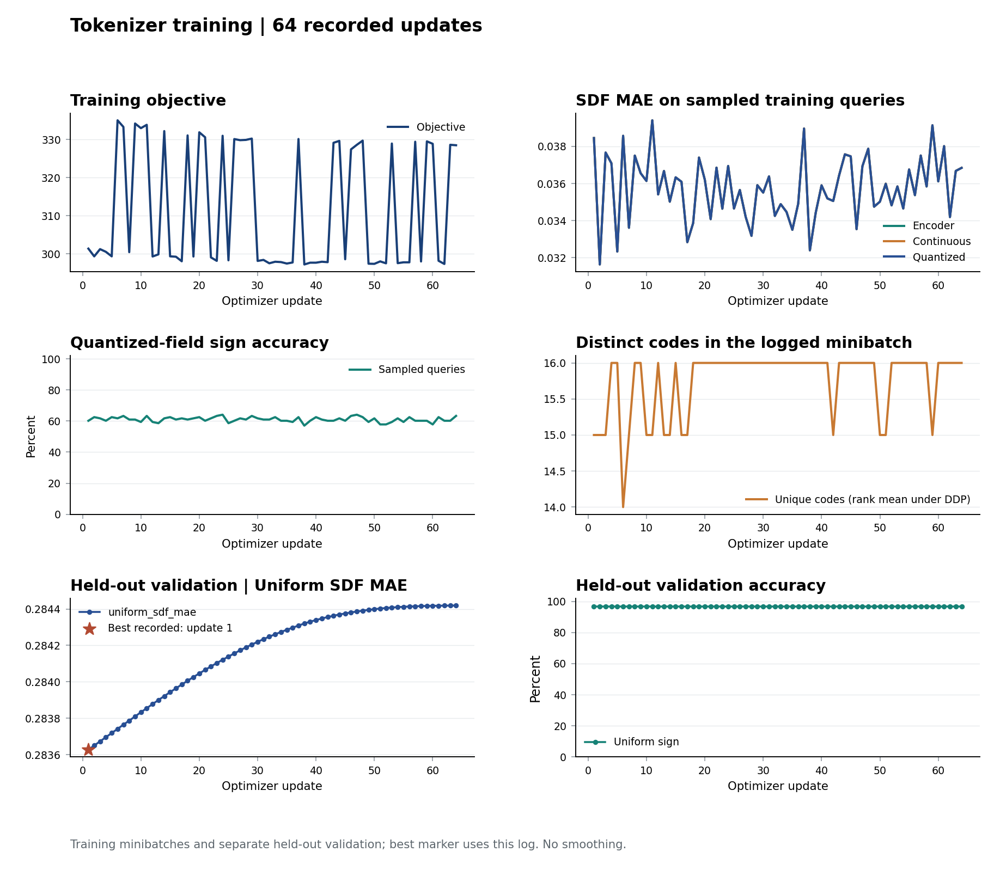
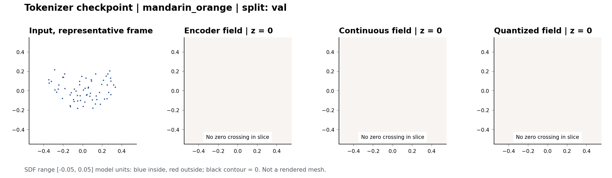
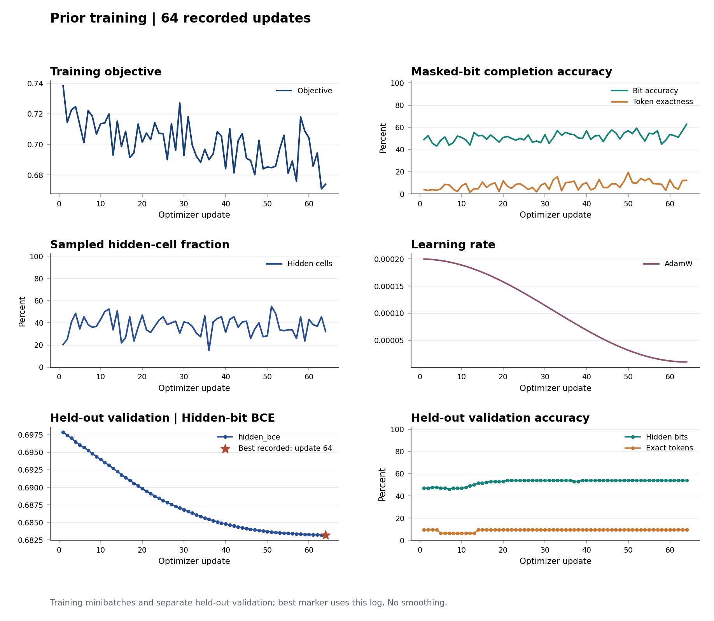
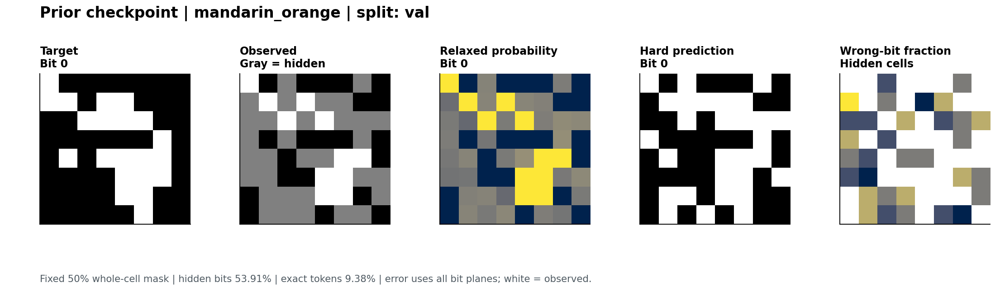

<!-- Geometric Orbit Representatives for Unaligned 3D Tokenization -->
<!-- Chair of Multimodal Machine Learning, ScaDS.AI Dresden/Leipzig -->
<!-- Contact: Xiang Chen <xiang.chen@uni-leipzig.de> | SPDX-License-Identifier: MIT -->

# Training And Diagnostics

[Back to Main README](../README.md)

## Configuration

The `*_demo.yaml` presets are small CPU pipeline checks. The reference presets
retain the active architecture and objective settings; see the
[result-to-config mapping](PRETRAINED.md#result-mapping) before choosing one.
Training quality requires suitable data and a full training budget.
[Pretrained pairs](PRETRAINED.md) are distributed separately from source code.
The seed defaults to `seed` in the configuration, otherwise 2026; an explicit
`--seed` takes precedence. See [paper reproduction](REPRODUCTION.md) before
comparing a new training run with the reference checkpoints.
For learned-centroid VQ and masked-index CE training, see the
[baseline guide](BASELINES.md). Both use this engine, including validation,
resume, initialization and `torchrun`.
[METHOD.md](METHOD.md) describes the active model.

`--batch-size` is per process. Effective batch size is approximately
`batch_size * world_size * Trainer.accumulate_grad_batches`; the last partial
batch can be smaller. Adjust these values when changing GPU count.

Both training commands support `torchrun`: NCCL on CUDA, Gloo on CPU. For
multiple machines, set `--nnodes`, `--node-rank`, `--master-addr` and
`--master-port`; all nodes must see the same data and config. Only rank zero
writes logs and checkpoints. Prior BCE uses a global hidden-bit denominator.

## Initialize From Weights

Use a compatible portable checkpoint to start a new fine-tuning run:

```bash
orbit train-tokenizer --config configs/tokenizer_paper.yaml \
  --init-checkpoint checkpoints/official/reconstructive/tokenizer.pt \
  --data data/imported --output outputs/tokenizer_finetuned --device cuda
```

`--init-checkpoint` copies all model parameters and buffers with strict name and
shape checks. It starts a fresh optimizer, scheduler, scaler, seed and update
counter. It accepts weights-only checkpoints as well as prior training states;
no optimizer state is reused. Prior initialization additionally requires a
verified binding to the tokenizer that produced the new cache.

Keep the active architecture and numerical conventions compatible. Same-shaped
weights alone do not validate changed feature scales or decoder settings.
The source SHA256 and changed configuration keys are recorded in `run.json`
and checkpoints. This is a new experiment, not exact continuation or a paper
reproduction. `--resume` and `--init-checkpoint` are mutually exclusive; both
support `torchrun`. A fine-tuned tokenizer needs newly exported tokens and a
newly trained or appropriately paired prior.

## Resume

```bash
orbit train-tokenizer --config configs/tokenizer_paper.yaml \
  --data data/imported --output outputs/tokenizer --device cuda \
  --resume outputs/tokenizer/last.pt
```

New runs require an empty output directory. In-place resume must use that
directory's `last.pt`, with logs ending at its saved update. Branching from an
older checkpoint or `best.pt` requires a fresh directory. A crash that leaves
logs ahead of the last checkpoint is rejected rather than silently rewriting
history; resume that checkpoint into a fresh directory.

Exact resume requires unchanged planned epochs, seed, dataset contents, world
size, batch size and accumulation. The fingerprint hashes both the manifest and
every referenced file; startup therefore reads the dataset once on rank zero.
Optimizer, scheduler, scaler, Python/NumPy/PyTorch per-rank RNG, sampler epoch
and batch position are restored. Legacy checkpoints without a content
fingerprint cannot provide exact resume. For weight migration,
see [CHECKPOINTS.md](CHECKPOINTS.md). CUDA scatter operations can be
nondeterministic; CPU tests do not certify multi-GPU throughput or bitwise
equality across devices.

## Held-Out Validation

Validation is enabled by default and requires a disjoint `val` split. It runs
at completed epoch boundaries, without random rotations, and restores training
RNG afterward. Each validation sample is evaluated once, including under DDP.
The legacy defaults select `best.pt` by uniform-field SDF MAE or hidden-bit BCE
under a fixed, sample-indexed 50% mask. Paper presets now record both raw and
truncated SDF error plus pooled token support; their diagnostic `best.pt` uses
truncated SDF MAE, consistent with SDF training targets. Prior presets evaluate
all five mask ratios and use the equal-weight mean of per-ratio BCE/CE for
diagnostic checkpoint selection. Accuracy terms are pooled by actual support
counts within each ratio. Scores are saved to `validation.jsonl`.

```yaml
Validation:
  enabled: true
  every_epochs: 1
```

`best.pt` is written only after validation; a short `--max-steps` run that stops
mid-epoch may have only `last.pt`. If a dataset intentionally has no validation
split, set `Validation.enabled: false` and document how its checkpoint is chosen.
Never substitute the test split for validation.

The paper reproduction workflow defaults to the fixed-budget **`last.pt`**, as
the original experiments did. A validation-selected tokenizer can stop early
with respect to token support even after the full training budget was executed.
`tools/reproduce.py --checkpoint-selection best` is an explicit alternative run,
not an interchangeable checkpoint for a prior trained on `last.pt` tokens.

`Trainer.lr_scheduler_interval: epoch` matches the original epoch-wise cosine
schedule and is explicit in paper presets. The backward-compatible default is
`step`. Both modes preserve exact resume and do not advance the schedule when
every update is skipped. An effective batch does not specify LFQ entropy's
micro-batch statistics: changing batch size and accumulation is not guaranteed
to preserve the original optimization trajectory.

## Distance Calibration

The optional field calibration fits one existing shared-head bias on training
SDF observations, without retraining the encoder or quantizer:

```bash
orbit calibrate-field --checkpoint outputs/tokenizer/last.pt \
  --data data/imported_matched --weighting balanced --device cuda \
  --output outputs/tokenizer_distance.pt

orbit benchmark fidelity --checkpoint outputs/tokenizer_distance.pt \
  --data data/imported_matched --device cuda --encoder-points 8192 \
  --query-points 8192 --uniform-points 2048 --output outputs/fidelity_distance
```

The default uses 128 seeded training objects and all validation objects.
`--weighting balanced` uses the original per-shape SDF weights; `uniform`
uses unweighted Huber distance. The offset is bounded to +/-0.003 model units.
A candidate is retained only when validation query MAE is within 1%, uniform
MAE within 5%, and inside-gap, sign accuracy and surface residual do not worsen.
Otherwise the output retains the original weights. The JSON records both
candidates, fit/validation identities, guards and source hashes. No test split
is used to fit or accept the offset. Validate mesh metrics before testing a
new calibration recipe; distance calibration is separate from the unchanged
paper protocol and applies no smoothing.

When accepted, this changes the tokenizer's full identity hash even though its
encoder and quantizer tensors are unchanged. Do not substitute it for the
tokenizer bound to an existing cache/prior. Keep the original verified pair
for that completion experiment.

## Posterior Calibration

One positive temperature can also calibrate a bit-field prior's probabilities:

```bash
orbit calibrate-prior --checkpoint outputs/prior/last.pt --tokens data/tokens \
  --mask-ratio .75 --device cuda --output outputs/prior_calibrated.pt
```

This fits hidden-bit BCE on the explicit validation split, within temperatures
0.5-3, including the unchanged prior as a candidate. It rescales only the final
logit head and preserves the tokenizer binding. Positive scaling preserves
logit signs in exact arithmetic, but finite-precision threshold ties may differ.
Better probability calibration does not guarantee better decoded geometry;
check validation meshes before a fixed test evaluation. Source checkpoints
are not overwritten, and calibration outputs are weights-only artifacts.

## Sparse-Context Refinement

The unchanged paper prior trains with mask ratios in `[0.05, 0.60]` and a
separate 5% probability of dropping all context. Evaluating at 90% masking
therefore tests a gap in its training coverage. A refactored training run can
perform well at 50% and still degrade sharply at 90%; neither unit tests nor
50%-mask validation detect that problem.

The optional `prior_sparse_context.yaml` extends masking to `[0.05, 0.95]`.
It retains the architecture and loss, and refines a compatible trained prior
for 20 epochs at learning rate `2e-5`:

```bash
orbit train-prior --config configs/prior_sparse_context.yaml \
  --init-checkpoint outputs/prior/last.pt --data outputs/tokens \
  --output outputs/prior_sparse --device cuda --workers 4

orbit evaluate tokens --prior outputs/prior_sparse/last.pt \
  --tokens outputs/tokens --device cuda --output outputs/prior_sparse_test
```

The cache must be bound to the same tokenizer as the initialization checkpoint.
Use a disjoint validation split, then evaluate the fixed-budget checkpoint on
held-out test objects. This changes training coverage and adds optimization
steps; report it separately from the unchanged paper recipe. It is not a
replacement for training the tokenizer or the initial prior from scratch.

## Logged Metrics

- Tokenizer: objective, quantized-field SDF MAE, sign accuracy and distinct
  codes in the logged minibatch. Under DDP, code counts are rank means, not
  the global vocabulary union or dataset-level effective support.
- Prior: hidden-bit accuracy, exact-token accuracy and sampled hidden-cell
  fraction. Correct/count terms are pooled across ranks before division.
- Categorical prior: hidden-index CE and exact-token accuracy, with counts
  pooled across ranks. There are no bit metrics or relaxed VQ states.
- `metrics.jsonl`: every logged objective component, schedule and learning
  rate. With gradient accumulation, diagnostics describe the final
  microbatch of each optimizer update, not an accumulation-window average.
- `skipped_updates.jsonl`: mixed-precision overflow events. A skipped update
  consumes its data batch but does not advance the optimizer-step counter,
  learning-rate schedule or curriculum. Full-precision nonfinite gradients
  raise an error. If every attempted update overflows, the run also exits with
  an error rather than reporting successful training; diagnostic logs and the
  checkpoint are retained. On supported GPUs, `Trainer.precision: bf16-mixed`
  avoids FP16's narrow range. Alternatively use `32-true` or lower
  `Trainer.amp_init_scale` (default 65536) for FP16. Changing precision starts
  a new experiment, not a claim of identical paper numerics.

`training.png` is generated at run completion; regenerate it from a running
job without loading model weights:

```bash
orbit plot-training --run outputs/tokenizer
```

When `validation.jsonl` is present, the figure adds separate held-out score and
accuracy panels and marks the lowest recorded selection score. Training and
validation are not mixed into one curve. `training.plot.json` records plotted
updates and the best score; a branched run's marker describes its local log,
not an earlier checkpoint that is absent from that directory.

Add `--data` to inspect the saved `last.pt`. Tokenizer previews show the
observed representative and encoder/continuous/quantized SDF slices at
`z=0`, with a common color range. Black contours mark zero crossings. A
slice without a zero crossing is labeled explicitly. Prior previews show
target/observed bits, relaxed probabilities, thresholded bits and a hidden
cell error map under a fixed 50% whole-cell mask.

```bash
orbit plot-training --run outputs/tokenizer --data data/imported --split val
orbit plot-training --run outputs/prior --data data/tokens --split val
```

The preview identifies its sample and split and writes a JSON sidecar. A
sample visualization is not an aggregate evaluation. Use the independent
[evaluation tools](../applications/README.md#field-evaluation) for held-out
metrics, mesh extraction and validity checks.

## Example Outputs

These are actual 64-update CPU runs with the demo presets and bundled
2/1/1 split, seed 2026, using centroid normalization and the Quick Start's
4,096/8,192/2,048 surface/query/uniform preprocessing counts.
They demonstrate logging, not paper-quality learning:
the tiny tokenizer is still poorly trained. No curve is smoothed or edited.
The [raw logs and provenance](../assets/training/) accompany the images.






Reproduce the run, using a fresh output directory:

```bash
orbit train-tokenizer --config configs/tokenizer_demo.yaml \
  --data data/samples/processed --output outputs/readme_preview/tokenizer \
  --device cpu --threads 2 --epochs 64 --max-steps 64
orbit cache-tokens --checkpoint outputs/readme_preview/tokenizer/last.pt \
  --data data/samples/processed --output outputs/readme_preview/tokens
orbit train-prior --config configs/prior_demo.yaml \
  --data outputs/readme_preview/tokens --output outputs/readme_preview/prior \
  --device cpu --threads 2 --epochs 64 --max-steps 64
orbit plot-training --run outputs/readme_preview/tokenizer --data data/samples/processed
orbit plot-training --run outputs/readme_preview/prior --data outputs/readme_preview/tokens
```

[Back to Main README](../README.md#training)
